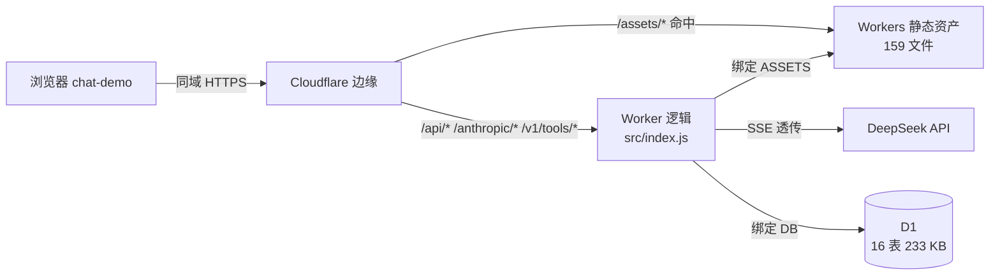
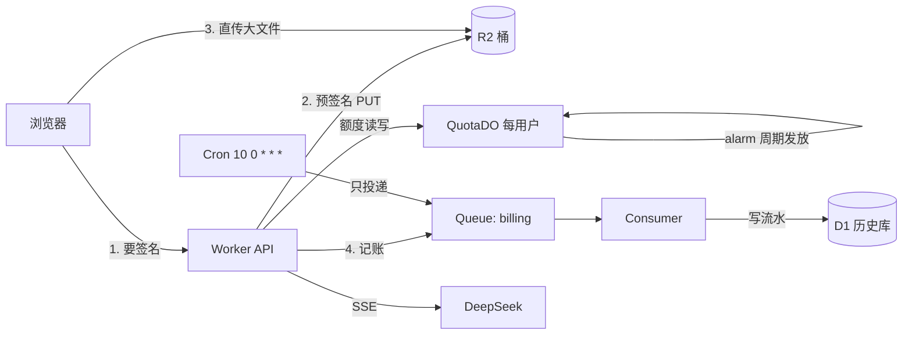

# 架构评审：Workers + 静态资产 + D1 的能力边界

> 目的：把「平台限制」和「我们的 7 个风险」对上号，再给出分阶段的架构调整方案。
> 所有数字来自 Cloudflare 官方 limits 文档（2026-11 抓取）+ 本机实测，实测项单独标注。

---

## 1. 现状

一个 Worker 同时承担三件事：静态站点、API 网关、额度与历史存储。

关键事实：

- 部署单元是 **一个 Worker 版本**，静态资产和 API 一起发。
- 单库：`model-test-demo-db`，WEUR，16 张表，233 KB。
- 账号实际是 **Workers Paid**（实测依据见 §5）。
- 没有 Pages 项目——这是对的，官方已把新项目导向 Workers Static Assets。

---

## 2. 硬限制清单（只列和我们有关的）

### 2.1 执行模型（Workers）

| 项 | Free | Paid | 对本项目意味着 |
|---|---|---|---|
| 请求数 | 10 万/天 | 不限 | Paid 下不是约束 |
| CPU/请求 | **10 ms** | 30 s 默认，可调 **5 min** | R2 的根因；Paid 下余量约 1 万倍 |
| 内存/isolate | 128 MB | 128 MB | 上传不能进内存缓冲，只能流 |
| 出站子请求 | 50/请求 | 10,000（可调到 1000 万） | 一个聊天请求 3–4 个，够 |
| 同时对 D1 连接 | 6 | 6 | 并发写会排队（见 2.2） |
| 请求体 | 100 MB（随 zone 计划，不随 Workers 计划） | 同 | 上传硬顶；且大文件不该走 Worker |
| 响应体 | 无限制 | 无限制 | SSE 可以一直流 |
| HTTP 时长 | **无限制**（客户端连着就行） | 同 | 「30 s」不是流时长，是 CPU |
| `waitUntil` 延长 | 30 s | 30 s | 响应后收尾只有 30 s |
| Cron | 5 个/账号 | 250 个 | 够用；但有 wall 15 min、无重试保证 |
| 日志 | 256 KB/请求 | 同 | 排障必须靠 `wrangler tail` 现抓 |
| 静态资产 | 20,000 文件 / 25 MiB 单文件 | 100,000 / 25 MiB | 现在 159 个文件，远未到 |

### 2.2 数据（D1）——最硬的一段

| 项 | 值 | 对本项目意味着 |
|---|---|---|
| 单库大小 | 10 GB（Paid）/ 500 MB（Free） | 目前 233 KB |
| **单库并发** | **单线程，一次一条查询** | 全站写吞吐 = 1/写耗时；实测写约 5 ms → **约 200 写/秒封顶** |
| 查询数/调用 | **1000**（Paid）/ **50**（Free） | 直接决定会话同步的批量上限（R3） |
| 单行最大 | **2 MB** | 整条 assistant 消息塞一行 `content_json`，超长回答会撞（潜在新风险） |
| SQL 语句长度 | 100 KB | 整会话 upsert 拼语句时要注意 |
| 绑定参数/查询 | 100 | 多行插入必须拆批 |
| 单查询时长 | 30 s | 大范围 UPDATE 必须分批（R4） |
| 结果集 | 50 MB | 列表接口要分页 |
| 列数/表 | 100 | 无影响 |
| 库数量 | 10（Free）/ 1,000,000（Paid，前 10 万免费） | 预留「按用户分库」这条路 |
| 事务 | 只有 `batch()` 原子，**不能跨请求** | R5/R6 的根因 |
| 读复制 | 已 GA，Sessions API 提供 read-your-writes | 读扩展有路，写仍单点 |
| 计费 | 按 rows read / rows written | Free 5M 读/天、10 万写/天；Paid 25B 读、50M 写/月 |

### 2.3 其他可用积木

| 产品 | 关键限制 | 适合解决什么 |
|---|---|---|
| **Durable Objects**（SQLite） | 每对象单线程、软限 ~1000 req/s、10 GB/对象、8 MB 值、alarm 15 min wall、CPU 30 s→5 min；账号 500 类（Paid） | 单用户串行化计数器、周期发放闹钟、WebSocket |
| **Queues** | 消息 128 KB、重试 100 次、批量 100、单队列 5000 msg/s、保留 14 天、consumer 15 min wall | 记账、清理、批量补发——替代「cron 里一把梭」 |
| **Workflows** | 每步时长无限、状态 1 GB、最多 25,000 步、`step.sleep` 最长 365 天、5 万并发实例 | 多步长流程（开户+发放+对账） |
| **R2** | 无 egress 费、S3 兼容、支持预签名 URL | 大文件、消息体大块、备份 |
| **KV** | 最终一致、读快写慢 | 热点读缓存 |
| **Containers** | 可跑任意镜像 | OCR / PDF / ffmpeg 这类 Worker 干不了的活 |

### 2.4 Pages（我们没用到，但值得记一笔）

构建 500 次/月、单次 20 min 超时、20,000 文件、25 MiB/文件、100 个项目；Functions 的计费和限制**完全等同 Workers**。也就是说 Pages 只多一层壳，能力反而更少（没有 Durable Objects / Cron 的完整入口）。**结论：留在 Workers，不要回头上 Pages。**

---

## 3. 平台限制 → 我们的 7 个风险

| 风险 | 直接根因的限制 | 说明 |
|---|---|---|
| R1 上传三免（免额度/免限流/无大小校验） | 请求体 100 MB 上限 + Worker 只能流式透传 + 没有计费钩子 | 平台不会帮你记账，得自己在签名/落盘处做 |
| R2 逐帧 JSON.parse 吃 CPU | CPU 10 ms（Free）/ 30 s（Paid） | 实测 0.46 µs/帧，Paid 下可忽略 |
| R3 同步上限 200 vs 500 | **1000 查询/调用** + 100 绑定参数 + 100 KB 语句 | 不是随便定的数，是查询预算 |
| R4 rollPeriods 无分批无容错 | 单查询 30 s + Cron wall 15 min + 无重试保证 | 用户一多必然半途而废 |
| R5 pending 无兜底 | **不能跨请求事务** | 结算只有 `batch()` 原子性，进程被杀就丢 |
| R6 并发小幅超额 | 无 `SELECT FOR UPDATE` | 只能条件 UPDATE + 预占 |
| R7 402 显示「服务器繁忙」 | 无（纯前端） | 与平台无关 |

一句话：**除了 R7，其余 6 条全部源自「D1 单库单线程 + 无跨请求事务 + CPU 预算」这三件事。**

---

## 4. 结构性诊断

1. **写吞吐有个天花板，而且我们离它不远**
   一次聊天 = `startRequest`（1 读 1 写）+ `settleUsage`（4 写）+ 可能的 `usage_daily`（1 写）≈ **6–7 次写**。
   实测单库约 200 写/秒 → **全站约 30 并发聊天就饱和**。
   会话同步更狠：200 条消息一次 PUT = 200 次写 ≈ 1 秒（实测），**一个用户点一次「保存」就独占整库 1 秒**。

2. **没有跨请求事务，所有不变量都得自己补偿**
   正确姿势我们已经写了（条件 UPDATE + `changes()` 判定 + `quota_ledger` 流水），但「预占 → 结算 → 超时释放」这条链路必须靠 `usage_requests` 状态机 + 定时兜底，这就是 R5 的由来。

3. **2 MB 行限制是个定时炸弹**
   我们把整条 assistant 消息（blocks、thinking、usage、附件引用）序列化进 `content_json` 一行。超长回答 + 长思考，单行接近 2 MB 时插入会直接失败，而且是**静默的同步失败**（与 R3 同一条路径）。

4. **没有长驻内存/进程内缓存**
   isolate 随时回收，`loadQuota` 每次至少 2 次读。热点只能放 KV 或 DO。

5. **可观测性偏薄**
   只有 `wrangler tail` + 256 KB/请求日志，没有 APM、没有慢查询面板。所以上面这些数字只能靠临时探测拿到。

6. **运行时不等于 Node**
   没有 `fs` / 原生模块。将来要做 PDF 解析、图片处理、音视频，只能上 Containers 或外部服务。

7. **发布面耦合**
   改一行前端也要整站 deploy；没有灰度（可以用 versions + 分流补，但要多做一层）。

---

## 5. 实测记录（2026-11-17）

| 实验 | 结果 | 推论 |
|---|---|---|
| 5000 帧全量 `JSON.parse` | 2.29 ms | 0.46 µs/帧，R2 在 Paid 下可忽略 |
| 0.44 MB 会话 JSON `JSON.parse` | 0.26 ms | 反序列化不是瓶颈，写库才是 |
| 会话 PUT 40 / 60 / 200 条 | 全部 200 OK，各约 0.9–1.0 s | ① 每次调用 200+ 条 D1 查询成功 → **账号是 Workers Paid**（Free 的 50 查询上限必挂）；② 耗时与条数近似线性 → **约 5 ms/写**，单库写吞吐 ~200/s |

---

## 6. 三种调整方案

### A. 留在 Workers，替换四处结构性短板（推荐现在做）

不改平台，只把「不该放在 Worker 里的事」挪走。

| # | 改动 | 解决 | 改动量 |
|---|---|---|---|
| A1a | 上传加护栏：Worker 端 size 预检 + 计量 + 纳入限流（文件仍走 DeepSeek Files API，模型要读它发的 `file_id`） | R1 全部 | 半天 |
| A1b | 文件自托管 R2、自己解析后喂模型（脱离 Files API 的成本与 100 MB 上限） | 需要 RAG/解析能力时才做 | 1–2 天 |
| A2 | 额度迁到 **每用户一个 Durable Object**（串行化余额 + alarm 做周期发放） | R4 / R5 / R6 的根因；D1 只留镜像 | 1 天 |
| A3 | 消息体超 64 KB 时 **外置 R2**，行里只存引用 | 2 MB 行限制（潜在） | 半天 |
| A4 | 定时任务改 **Queues**（重试/批量/保留），cron 只负责投递 | R4 的可靠性 | 半天 |

目标形态：

成本：Workers Paid $5/月起 + R2 存储费（几美分）；改动约 2–3 天。

### B. 边缘 + 中心库（增长到几千用户，或要真计费/报表时）

- CF 继续做 CDN / WAF / 静态资产 / 边缘鉴权。
- API + **Postgres** 放一台 $5 VPS（Hetzner / Fly.io），Caddy 反代，`pg_dump` 每日备份。
- 换来：真事务、行锁、窗口函数、PITR、`psql` 现场排障、任意 Node 库。
- 代价：多一个进程要维护；读延迟从「边缘就近读 D1」变成「回源一跳」。

### C. 完全自托管（多租户产品化）

Postgres + Redis/队列 + S3 兼容存储，Compose 或 K8s（可复用 model-arena 的 ECS + Caddy 那套）。只在有真实付费用户和 SLA 要求时做。

### 对比

| | A 留在 Workers | B 边缘 + 中心库 | C 全自托管 |
|---|---|---|---|
| 复杂度 | 低 | 中 | 高 |
| 月度成本 | $5–15 | $10–30 | $30+ |
| 写吞吐上限 | ~200 写/s（可用 DO 横向摊） | 数千写/s | 取决于硬件 |
| 事务能力 | 弱（batch + 补偿） | 强 | 强 |
| 运维负担 | 几乎为零 | 一台机器 + 备份 | 全套 |
| 迁移成本 | — | 2–3 天（改数据层） | 1–2 周 |

---

## 7. 触发阈值（用数字决定何时升级，而不是凭感觉）

| 指标 | 当前 | 阈值 | 动作 |
|---|---|---|---|
| 单库写速率（持续 5 min） | 接近 0 | >150 写/s | A2 上线；或按用户 hash 分 N 库 |
| 单次会话 PUT 耗时 p95 | ~1 s（200 条） | >2 s | 改增量同步（只推 diff 消息），别再整会话覆盖 |
| 单条消息体 | 平均 <20 KB | 任一 >512 KB | A3 外置 R2 |
| 活跃用户 | 1 | >1,000 | 评估方案 B |
| 日请求 | 少量 | >1,000 万/月 | 只是成本问题，Paid 已覆盖 |
| 需要跨表强一致流程 | 无 | 出现第一个 | 方案 B |

---

## 8. 建议路线

1. **现在**：补上 `DEEPSEEK_API_KEY` 把真实链路跑通；同时做 A1a（上传护栏）和 R3 的上限统一——这两件是「成本无上界」和「数据静默丢失」，比 CPU 重要一个数量级。A1b（R2 自托管）等有解析需求再说。
2. **随后**：A2（QuotaDO）+ A4（Queues），一次把 R4/R5/R6 的根因拔掉，D1 退回纯历史库。
3. **观察**：按 §7 的阈值表盯数字。写速率破 150/s 或活跃用户破千，再启动方案 B；在那之前迁 Postgres 是纯浪费。

---

## 附：本次评审没有改任何业务代码

只新增本文档，外加一次线上探测（临时邀请码 + 三个 PUT，测完已清理：`probe_*` 会话/消息/邀请码均为 0）。
