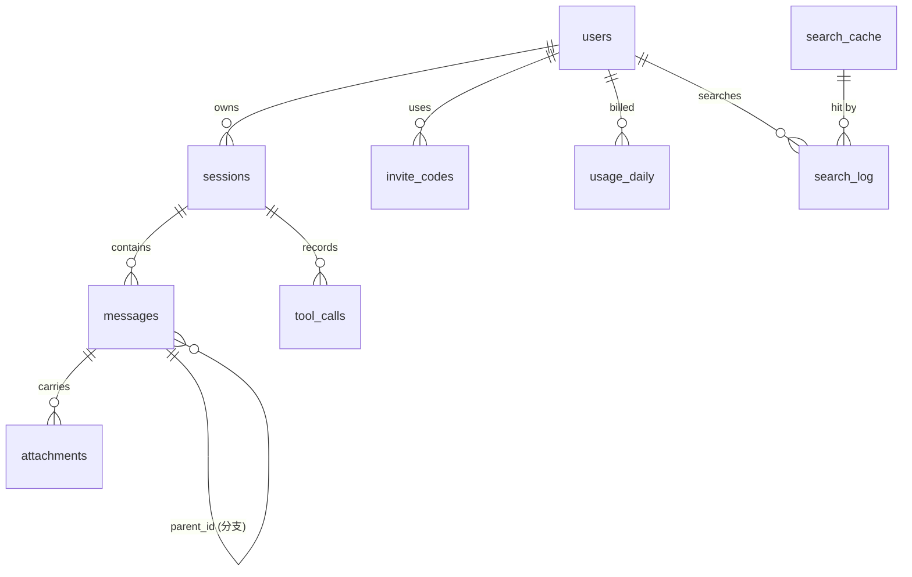

# 数据库设计（v2）

面向两件事：**存用户**、**存对话历史**，外加联网搜索（Firecrawl）的缓存与成本账。

DDL 见 [`db/schema-v2.sql`](../db/schema-v2.sql)，本文只讲为什么这么设计、怎么迁、后面怎么接。

额度/计费单独一套表，见 [quota.md](quota.md) 与 [`db/quota.sql`](../db/quota.sql)。

## 1. 定位：服务端是副本，不是主库

chat-demo 是本地优先的：会话、消息、分支、附件原件全在浏览器 IndexedDB（`web/src/services/chat/db.ts`，`chat-demo` 库 v11）。所以服务端库的角色是：

- **备份**：换设备、清缓存不丢历史
- **同步**：多端拉同一份会话
- **审计/计费**：谁在什么时候问了多少、烧了多少 token、搜了几次

由此推出一条硬约束：**服务端不生成 id**。会话 id、消息 id、附件 id 全部沿用前端生成的 uuid，否则同步时对不上。

## 2. 关系



## 3. 表设计要点

### users

`token_id` 直接做主键，不再要自增 `id`。Token 里带的就是这个 uuid，Worker 现在查的就是 `WHERE token_id = ?`，改名要动代码，没必要。

新增 `status`（封禁不删数据）、`quota_override`（单人放量，不动全局 `DAILY_QUOTA`）、`last_seen_at`（活跃度）。

### sessions

一行一个会话，存**元数据 + 分支指针**，不存消息。

- `root_message_id` / `selected_leaf_id`：对应前端 `Session.rootMessageId` 和每条消息的 `selectedChildId`。前者是分支树的根，后者是"当前看到哪一支的末端"。切换回答版本只改 `selected_leaf_id`，不写消息。
- `settings_json`：`{thinking, search}` 快照，恢复会话时还原开关。
- `deleted_at`：软删。前端删会话是立刻消失的，服务端留 30 天再物理清，防止误删同步把别的端也清了。

### messages

一行一条消息，**内容是 JSON**（`content_json`），不拆成 block 表。

- user：`{text, files:[{id,serverId,name,size,...}]}`
- assistant：`blocks[]`，就是前端 `ReplyBlock[]`（text / thinking / server_tool_use / web_search_tool_result / web_fetch_tool_result）原样存

为什么不分块：块的唯一用途是渲染，从不按块查询；拆表只会让一次回答变成 10 次 insert、N 次 join。

**入库前必须剥掉 `encrypted_content`**。搜索结果块里那个字段是服务端 AES 加密的 Base64，客户端本来也解不开，单条 3–5 KB，10 条结果就 40 KB。服务端副本只留 `{title, url, snippet, site_name, page_age}`。`read_link` 的 `signature` 保留在 `tool_calls.output_json` 里，续写需要时再取。

分支：`parent_id` 指向上一条。同一 `parent_id` 下多条 assistant 就是"重新生成"的多个版本，`sessions.selected_leaf_id` 决定当前展示哪条。

`status` 五态与前端一致（pending / streaming / done / stopped / error），`error_json` 存 `{kind, message, status, retryable}`。

### attachments

`id` 用前端本地 id，`server_file_id` 是 DeepSeek Files API 返回的 `file_id`。原件不进 D1（D1 不适合存二进制，单行上限 1 MB），原件留在浏览器，需要跨端时再上 R2。

### search_cache

Firecrawl 按 credits 计费（搜索 2 credits / 10 条结果，抓取 1 credit / 页，免费额度 1000 credits/月）。缓存键：

```
sha256("firecrawl|" + query.trim().toLowerCase() + "|" + limit + "|" + lang + "|" + freshness)
```

TTL 24 小时（时效性内容），`expires_at` 过期的行由定时任务删。命中缓存时 `search_log.status = 'cached'`、`credits = 0`。

### search_log / tool_calls

- `search_log`：一行一次搜索，用来算每人每日搜索次数、核对 Firecrawl 后台的 credits 消耗对不对得上。
- `tool_calls`：一行一次工具调用（`web_search` / `read_url` / 将来的 MCP 工具），存 input/output 原文，排查"模型为什么这么答"时看这个。

### usage_daily

替代 v1 的 `quota` 表。v1 只数次数，v2 顺手记 token：`requests / input_tokens / output_tokens / cached_tokens / search_calls`，主键 `(user_id, day)`，day 取 UTC 日期（和现在 `today()` 一致）。

**顺手修掉 v1 的扣费 bug**：现在 `incrQuota` 在 `fetch` 之前跑，上游 401/502 也照扣（实测失败请求后 used 0→1）。v2 改成拿到 `message_start` 后再写 `usage_daily`，失败不记账。

### provider_keys

**只存元数据，不存密钥值**。`provider / label / key_tail / enabled / weight`，用来做多 key 轮换和"这把 key 还剩多少额度"的人工核对。真实值只走 `wrangler secret`。

## 4. 需要的 Key

| Key | 用途 | 存放 | 现状 |
|---|---|---|---|
| `AUTH_SECRET` | 签发/校验用户 Token（HMAC-SHA256） | Worker secret | ✅ 已配 |
| `DEEPSEEK_API_KEY` | 上游模型调用 | Worker secret | ❌ **未配**，现在转发头是 `Bearer undefined` |
| `FIRECRAWL_API_KEY` | 联网搜索 / 抓网页 | Worker secret | ⬜ 待配，`fc-` 开头 |
| `CLOUDFLARE_API_TOKEN` | 可选，CI 自动部署 | GitHub Secrets | ⬜ 可选 |

配置命令：

```bash
cd worker
wrangler secret put DEEPSEEK_API_KEY
wrangler secret put FIRECRAWL_API_KEY
```

## 5. 联网搜索：Firecrawl 替换服务端搜索

### 为什么不直接用 `deepseek_web_search`

chat-demo 现在声明的是 DeepSeek 服务端工具（`tools: [{type:'deepseek_web_search'}]`），搜索由上游做，我们看不到 query、拿不到原始结果、也没法缓存和限流。换成 Firecrawl 后：query 可审计、结果可缓存、成本可核算、失败可降级。

代价：得自己跑工具循环，上游不再替我们搜。

### 接口

```bash
# 搜索
POST https://api.firecrawl.dev/v2/search
Authorization: Bearer $FIRECRAWL_API_KEY
{ "query": "...", "limit": 5,
  "sources": [{"type":"web"}],
  "scrapeOptions": { "formats": [{"type":"markdown"}], "onlyMainContent": true } }
# → { success, data: { web: [{url,title,description,position,markdown?}] } }

# 抓单页（read_url）
POST https://api.firecrawl.dev/v2/scrape
{ "url": "...", "formats": ["markdown"] }
```

### Worker 侧流程

```
1. 前端请求带 tools: [{name:'web_search'}]（自定义工具，不再是 deepseek_web_search）
2. Worker 转发 → 模型返回 stop_reason='tool_use' + tool_use{name:'web_search', input:{query}}
3. Worker 查 search_cache
     ├ 命中 → 直接用
     └ 未命中 → 调 Firecrawl /v2/search → 归一化 → 写缓存 + search_log
4. 把 tool_result 拼回 messages，再请求一次模型（最多 3 轮）
5. 最终回答按 SSE 流式回前端；轮次中间的非流式响应在内存里拼
```

要点：

- **轮次上限 3**，超了直接返回当前文本，避免无限循环烧钱
- **每人每日搜索上限**（建议 10 次，`usage_daily.search_calls` 判），超了降级为"不带搜索直接答"
- **并发同 query 去重**：D1 没有锁，两个请求同时未命中会各调一次 Firecrawl。可以接受（多花 2 credits），也可以加 `search_cache` 的 `INSERT OR IGNORE` 占位行 + 轮询，先不做
- 前端 `parseEvent.ts` 已经能解析 `web_search_tool_result` 块，返回结构对齐它就不用改前端

### 成本

按 2 credits / 10 条结果算，`limit: 5` 一次约 1 credit。1000 免费 credits/月 ≈ 1000 次搜索。缓存命中率按 30% 估，够 1400 次实际搜索。

## 6. 迁移

现有库只有 1 个未用邀请码、0 用户、0 配额行，可以直接重建。

```bash
cd worker
# 1) v1 的 quota 表废弃，users 结构变了
wrangler d1 execute model-test-demo-db --remote --command \
  "DROP TABLE IF EXISTS quota; ALTER TABLE users RENAME TO users_v1;"

# 2) 建 v2 全量结构（可重复执行）
wrangler d1 execute model-test-demo-db --remote --file ../db/schema-v2.sql

# 3) 回填老用户（v1 的 created_at 是 TEXT，转毫秒）
wrangler d1 execute model-test-demo-db --remote --command \
  "INSERT INTO users (token_id, created_at) SELECT token_id, CAST(strftime('%s', created_at) AS INTEGER)*1000 FROM users_v1; DROP TABLE users_v1;"
```

有真实用户时别用 `DROP`，改成建新表 → `INSERT INTO ... SELECT` → 校验行数 → `RENAME`，中间不要 `DROP`。

## 7. 同步 API 草案（下一阶段）

| 方法 | 路径 | 说明 |
|---|---|---|
| GET | `/api/sessions?since=<ms>` | 增量拉会话摘要（不含消息） |
| GET | `/api/sessions/:id` | 拉完整会话（消息按 `created_at` 升序） |
| PUT | `/api/sessions/:id` | upsert 会话 + 增量消息，body 带 `updatedAt` |
| DELETE | `/api/sessions/:id` | 软删 |

冲突策略：**last-write-wins，客户端胜**。会话是单人单设备编辑的，跨端同时改同一会话的概率极低，做 CRDT 不划算。

写入约束：单次 PUT 最多 200 条消息（D1 单次调用 1000 条 query 上限，留余量）；消息体超过 200 KB 拒绝并提示。

## 8. 容量估算

- 一条消息 JSON 平均 2–4 KB（剥掉 `encrypted_content` 后）
- 一个会话 20 条消息 ≈ 60 KB
- 100 用户 × 50 会话 = 5000 会话、10 万条消息 ≈ 300 MB

D1 免费额度 5 GB 存储 / 每天 500 万行读，够用很久。真到瓶颈先清 `search_cache` 和 30 天前的软删会话。

## 9. 待定

- 附件原件要不要上 R2（跨端查看原图需要，现在只有本地有）
- `sessions.title` 是前端截断生成的，还是用上游返回的 `message_delta.title`（chat-demo 已支持 `title: {enabled:true}`）
- 多 key 轮换的触发条件：按 `search_log`/`usage_daily` 的失败率，还是按 Firecrawl 的 credit 余额接口
